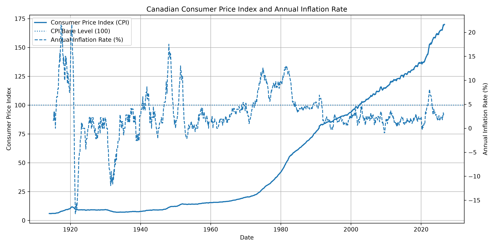

# FINE3300-2026-A2

## Introduction
This is a Consumer Price Index (CPI) Inflation Calculator created using Python. It uses monthly Canadian CPI data from the Bank of Canada to show how inflation affects the purchasing power of money over time.

The code allows the user to enter an original price and select two different months and years (one each to start from, and one each to end from). It then uses the entered values to calculate the equivalent price at the ending date, the difference in price, the overall percentage change, and the annualized inflation rate.

The code also creates a graph that displays the changes in Canada's CPI and annual inflation rate over time.

## Files Included
- `InflationCalculator.py`: This is the main Python code. It reads the CPI dataset, creates the graph, accepts user input, and calculates inflation.
- `STATIC_INFLATIONCALC.csv`: This is the monthly Canadian CPI dataset downloaded from the Bank of Canada website (https://www.bankofcanada.ca/rates/related/inflation-calculator/).
- `cpi_graph.png`: This is a graph generated by the Python code showing the CPI and annual inflation rate over time using data from the above csv file.

## Python Libraries Used
The project uses these three Python libraries to help generate the results:
- **Pandas**: This library is used to read the CSV file, organize the CPI data into a DataFrame, convert dates, and calculate the percentage changes.
- **NumPy**: This library is used to perform the mathematical calculations for the annualized inflation rate.
- **Matplotlib**: This library is used to create and display the graph of CPI and annual inflation over time.

## How to Run the Program
1. Clone this project repository.
2. Make sure Python is installed on your computer.
3. Install the libraries by entering the following command in the terminal: `pip install pandas numpy matplotlib`
4. Make sure that `STATIC_INFLATIONCALC.csv` and `InflationCalculator.py` are saved in the same folder.
5. Open the folder in VS Code.
6. Run `InflationCalculator.py`.
7. Follow the prompts in the terminal to enter an original price and the starting and ending dates.

***Keep in mind***:
- The pop-up image of the graph that appears after running the code **must** be closed before you are able to see the calculation section.
- Dates must be entered using the YYYY-MM format. For example, January 2010 would be entered as `2010-01`.
- The selected dates must also exist in the CPI dataset
- The ending date must be later than the starting date.

## Graph Information
The code generates a graph showing Canada's monthly Consumer Price Index and annual inflation rate. The CPI is displayed using the left vertical axis, while the annual inflation rate is displayed using the right vertical axis. The annual inflation rate is calculated by comparing each month's CPI with the CPI from the same month one year earlier. The graph is saved as `cpi_graph.png` when the program is run.

The graph helps illustrate how the general price level and annual inflation rate have changed over time. An increase in the CPI tells us that the overall price level has increased when compared with the CPI base period. The annual inflation rate shows how quickly prices have changed compared with the same month in the previous year.



The Consumer Price Index (CPI) shows that the cost of living in Canada has steadily climbed since 1914. Prices have grown much faster over the decades, moving from single digits up to over 160.

The graph also shows some memorable historical moments. Right after World War I, around 1920, prices spiked heavily before crashing down during the Great Depression in the 1930s. Then during the 1970s and 1980s, inflation bounced up and down with many high peaks. More recently, we can also see another sharp jump in inflation after the pandemic around 2021 and 2022.

## Inflation Calculation
The code uses these formulas to calculate the results:
- **Equivalent Price**: Equivalent Price = Original Price × (Ending CPI / Starting CPI)
- **Price Difference**: Price Difference = Equivalent Price − Original Price
- **Percentage Change**: Percentage Change = [(Ending CPI / Starting CPI) − 1] × 100
- **Annualized Inflation Rate**: Annualized Rate = [(Ending CPI / Starting CPI)^(12 / Number of Months) − 1] × 100

The code also calculates the time difference between the two selected dates in years by subtracting the two time periods from each other.

### Sample output
Below shows an example of the results displayed by the program. The actual values depend on the price and dates entered by the user. In this case, the user entered $100 as the original price, September 1914 as the starting date, and September 2026 as the end date. 
```
------------------------------------
------CPI INFLATION CALCULATOR------
Enter the original price ($): 100
Enter the starting date (YYYY-MM): 1914-09
Enter the ending date (YYYY-MM): 2026-09
--------CALCULATION RESULTS---------
Original price: $100.00
Starting date: September 1914
Ending date: September 2026
Starting CPI: 6.00
Ending CPI: 170.00
------------------------------------
Equivalent price: $2,833.33
Difference in price: $2,733.33
Overall percentage change: 2733.33%
Time difference: 112.00 years
Annualized inflation rate: 3.03%
------------------------------------
```
## Conclusion
This project shows how Python can be used to work with economic data and perform financial calculations. By using packages such as Pandas, NumPy, and Matplotlib, the code organizes historical CPI data, visualizes inflation trends, and calculates how the purchasing power of money changes over time. 

